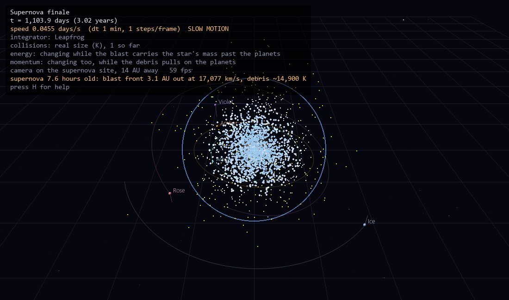

# 3D Gravity Sandbox

A 3D N-body gravity sandbox in Python, and the 3D successor to
[Binary-Star-Gravity-Sandbox](https://github.com/24f3002958/Binary-Star-Gravity-Sandbox).



## What's new compared with the 2D version

| 2D version | This version |
|---|---|
| Flat orbits | Full 3D: orbits can tilt; drag to rotate the view, scroll to zoom |
| Semi-implicit Euler, bodies moved one at a time | Leapfrog integrator; all forces come from the same positions in one numpy pass, so momentum is conserved |
| No way to see how accurate it is | Live energy-drift and momentum-drift readouts; press I to compare integrators |
| One hand-made scene | Presets: a white-dwarf supernova, a black hole, the real solar system from NASA/JPL Horizons, the figure-8 orbit |
| Orbit trail grows forever | Fixed-length, fading trails |

## Setup

Needs Python 3.10 or newer (tested on 3.15).

```powershell
python -m pip install -r requirements.txt
python main.py
```

`python main.py` starts on the supernova finale. `pygame-ce` is the actively maintained fork of pygame and
is imported the same way (`import pygame`). If the original `pygame` package is installed in the same
environment, uninstall it first (`python -m pip uninstall pygame`), because the two clash.

## Controls

| Input | Action |
|---|---|
| Drag mouse | Rotate the view |
| Mouse wheel | Zoom |
| 2 / 3 / 4 / 6 / 7 | Solar system / today's solar system (live from JPL) / figure-8 / supernova finale / black hole |
| Space | Pause |
| Up / Down | Double / halve the speed (also ends the supernova slow motion) |
| R | Restart the preset |
| I | Switch integrator: leapfrog, semi-implicit Euler, explicit Euler |
| K | Collisions: real sizes / drawn sizes / off |
| F / Shift+F | Follow the next / previous body (starts on the centre of mass) |
| T / C | Trails on or off / clear trails |
| L / G | Labels / grid on or off |
| [ / ] | Smaller / bigger bodies |
| H | Show or hide the help |
| Esc | Quit |

You can also choose the starting scene: `python main.py --preset blackhole` (choices: `supernova`, `solar`,
`solar-live`, `figure8`, `blackhole`).

## Presets

- **Supernova finale**: two white dwarfs with five planets on tilted orbits around them. The pair spirals
  together, faster and faster, with a countdown on screen. After about 37 seconds they merge and explode
  as a Type Ia supernova: the playback drops into slow motion while the blast sweeps past the planets,
  then speeds back up as the debris cloud brightens, cools from blue-white to red and fades, and the
  planets, no longer held by anything, coast off in straight lines.
- **Solar system**: the Sun and eight planets starting from real positions and velocities from
  NASA/JPL Horizons (a snapshot for 2026-11-25 is bundled in `data/`). Each planet's moons are folded into
  it, so "Earth" is really Earth + Moon.
- **Solar system (live)**: the same, but press 3 to download today's positions (needs internet; falls back
  to the snapshot if the download fails).
- **Figure-8**: three equal stars chasing each other around a figure-8, a famous periodic solution of the
  three-body problem. Switch to Explicit Euler (I) and watch it gain energy and swell out of shape (about
  50% wider after five laps), while leapfrog keeps it on track.
- **Black hole**: Sagittarius A*, the 4.3-million-Sun black hole at the centre of our galaxy, with
  neighbours on relativistic orbits. A pulsar's orbit swings round by about 50° a lap, tracing a rosette;
  a 10-Sun black hole does a "zoom-whirl", whipping almost twice round the hole on each pass; a white dwarf
  falls in whole after about 9 seconds, fading and reddening as it nears the horizon; and after about 23
  seconds a Sun-like star is torn apart by tides into a spaghetti-like stream: about a quarter of it falls
  straight in (with a flare), about half stays bound to the hole, the rest is flung away.

## The supernova

- **Why white dwarfs**: Sun-like stars that collide just merge into a bigger star. Supernovae from
  collisions come from *white dwarfs*, the leftover cores of Sun-like stars: Earth-sized but as heavy as
  the Sun. A white dwarf can't be heavier than about 1.44 Suns (the Chandrasekhar limit), so when these
  two (1.0 + 0.8 = 1.8 Suns) merge, the merged star blows itself apart completely and leaves nothing behind.
- **Why they spiral in**: two orbiting stars give off gravitational waves, which drain the orbit's energy
  so its size shrinks as r = r₀ (1 − t/T)^¼: slowly at first, then faster and faster (the "chirp" that
  LIGO detects). From 0.6 AU a real pair would take about 3×10¹⁶ years, so the effect is sped up about
  10¹⁶ times to take three years. It's modelled as a drag on the pair's relative motion with strength
  (r₀/r)⁴ / 8T, which drains energy and angular momentum in the same proportions as gravitational waves.
  The stars merge when their drawn spheres touch; by then a real pair would plunge together within hours.
- **The debris** (`physics.Ejecta`): the merged star's whole mass becomes 2,000 fragments flying outward.
  A few seconds after the explosion the gas is moving far faster than its own pressure or gravity can
  change, so each fragment coasts in a straight line. Their speeds follow the exponential density profile
  used for Type Ia supernovae (density ∝ e^(−v/vₑ), vₑ = √(E/6M)), with a kinetic energy of 1.5×10⁴⁴ J:
  about 8,000 km/s on average and 17,000 km/s at the leading edge. Most fragments are bunched into knots,
  like the clumpy debris in real supernova remnants.
- **What the planets feel**: by Newton's shell theorem a planet only feels the debris still inside its
  orbit, so each one keeps orbiting until the blast passes it and only then carries on in a straight line.
  The blast takes about half a day to cross the system, which is why the playback switches to slow motion
  (press Up or Down to take over the speed yourself).
- **How it looks**: fragments are coloured by temperature with a star-temperature colour scale (pale blue,
  white, yellow, orange, red), hottest at the slow centre, and cool from about 15,000 K to 4,000 K over the
  following months. The glow follows a Type Ia light curve: an early flash, a main peak about 18 days later
  (powered by radioactive nickel and cobalt), then a slow fade. The colour scale and the background stars
  are ideas from [peteraraujo/supernova](https://github.com/peteraraujo/supernova) (Apache-2.0), a 2D
  smoothed-particle-hydrodynamics (SPH) simulation of a star collapsing and exploding. Its SPH gas physics
  isn't used here because gas pressure only matters in the explosion's first seconds, and its neutron-star
  remnant belongs to a different kind of supernova: a Type Ia leaves nothing behind.

## The black hole

- **Relativistic orbits** (`physics.BlackHole`): Newton's pull multiplied by 1 + 3h²/(c²r²), where h is the
  orbiting body's angular momentum per unit mass. That gives exactly the orbit equation general relativity
  predicts for a body round a non-spinning black hole, u″ + u = GM/h² + 3GMu²/c² (with u = 1/r), so the
  orbit *shapes* are right: closest points precess by 3πr_s/(a(1−e²)) per orbit far out and much more close
  in, nothing orbits stably inside 3 r_s (the innermost stable circular orbit), and anything coming in with
  less angular momentum than 2r_s·c falls in. Timing very close to the hole is only approximate (this
  shortcut even lets speeds right at the horizon exceed light's), and the hole doesn't spin.
- **Swallowing**: anything that crosses the event horizon (r_s = 2GM/c², 12.7 million km for
  Sagittarius A*) is absorbed, even with collisions switched off. Bodies dim and redden as they get close,
  because light climbing out of the hole's gravity loses energy (by √(1 − r_s/r)).
- **Tides**: a star is torn apart inside R*(M_hole/M*)^⅓, 8.9 r_s for a Sun-like star round Sagittarius A*,
  which is outside the horizon (for holes above about 100 million Suns it's inside, and stars are swallowed
  whole, as the white dwarf is here). Its 400 fragments keep the star's velocity at that moment; the hole
  pulls harder on the near side, which spreads their orbital energies so that about half end up bound.
- **Timestep**: near the hole each step is 0.5% of the orbital timescale √(r³/GM) at whatever is closest, from
  2 minutes down to under a second, so whirls and plunges stay accurate.
- **How it looks**: the black disk is the horizon; the glowing ring at 2.6 r_s is the photon ring, the edge of
  the shadow a distant observer sees. Background stars are gravitationally lensed with the point-lens
  equation: each star near the line of sight appears twice, pushed out from the hole and magnified near the
  Einstein ring, and no starlight comes through the shadow. (That weak-field formula is only roughly right
  this close to a hole; bodies and debris aren't lensed.)

## Collisions

Bodies that touch merge into one: a planet that hits a star is swallowed, and two planets that hit each
other become one bigger planet. (The white dwarfs' merger goes through the same code.)

- **When**: every step checks each pair's whole path during that step, not just where the bodies end up,
  so a body moving at hundreds of km/s can't skip through another between two steps.
- **What happens**: a perfectly inelastic merger. The heavier body survives; mass and momentum are
  conserved, and the survivor's volume grows by the other's volume. Kinetic energy turns into heat, so
  the energy-drift readout restarts after each crash.
- **Sizes (K)**:
  - *Real size* (the default) uses actual radii, so crashes only happen on near-direct hits.
  - *Drawn size* uses the exaggerated sizes you see on screen, so crashes are much more frequent.
    [ and ] change these sizes too.
  - *Off* lets bodies pass through each other.

## How it works

- **Units**: the physics runs in SI units (m, kg, s); the viewer converts to AU for drawing. Bodies are
  drawn far bigger than their real size, or they'd be invisible.
- **Forces** (`gravity_sandbox/physics.py`): every pairwise pull in one vectorised numpy expression, with
  optional softening so close passes don't produce near-infinite forces, plus any extra fields such as
  supernova debris.
- **Integrator**: leapfrog (kick-drift-kick): half a velocity kick, a full position drift, recompute forces,
  the other half kick. It's second order and *symplectic*, so the energy error stays bounded instead of
  building up and orbits stay closed.
- **Speed control**: each frame covers `days_per_second / 60` days, split into steps no longer than the
  preset's `dt_max`, so speeding up takes more steps rather than less accurate ones.
- **Rendering** (`gravity_sandbox/app.py`): no 3D engine. An orbit camera projects points with a
  perspective divide, bodies are drawn far-to-near, and planets are shaded pixel by pixel from their
  star's direction, so you can see their day and night sides.

## Project layout

```
main.py                         entry point
gravity_sandbox/
    physics.py                  N-body state, forces, integrators, collisions, inspiral, supernova debris,
                                black-hole orbits and tidal disruption
    presets.py                  ready-made scenes (add your own here)
    horizons.py                 downloads real state vectors from JPL Horizons
    units.py                    constants and orbit helpers
    app.py                      pygame-ce 3D viewer
data/solar_system_snapshot.json
tests/                          pytest suite
```

## Tests

```powershell
python -m pip install -r requirements-dev.txt
python -m pytest
```

The tests check Newton's third law, that a circular orbit closes, that leapfrog conserves energy far better
than Euler, that the figure-8 returns to its start after one lap, that Mercury, Venus and Earth come out
with their real orbital periods (within 0.1%) from the JPL snapshot, that collisions conserve mass and
momentum and can't be skipped by a fast body, that the inspiral follows the gravitational-wave chirp, that
the supernova debris carries the right energy and pulls exactly like the star until it has passed, that the
finale explodes on schedule with every planet on a steady orbit until then (and coasting in a straight line
afterwards), that black-hole orbits precess at Einstein's rate far out, that nothing orbits stably inside
3 r_s, that capture needs less than 2r_s·c of angular momentum, that energy (with the relativistic term) is
conserved, that tidal debris is about half bound, that lensing puts images where the lens equation says,
and that the viewer runs off-screen, including the slow-motion blast and the black-hole scene.

## Refresh the solar-system snapshot

```powershell
python -m gravity_sandbox.horizons
python -m gravity_sandbox.horizons 2030-01-01
```

The first command uses today's date; the second, any date you give it.

## Ideas for next steps

- A spinning (Kerr) black hole, whose innermost stable orbit and frame dragging depend on the spin.
- A ray-traced accretion disk, lensed into the famous "Interstellar" shape.
- A Kozai–Lidov preset: a planet plus a distant companion star on an orbit tilted by more than 39°.
- Sun–Earth–Moon (needs a much smaller timestep than the solar-system preset).
- An adaptive timestep for close encounters (fixed steps lose accuracy during very close passes).
- An asteroid belt of massless test particles.
- Colliding stellar winds: draw the shock surface where two stars' winds meet, which sits where their wind
  momenta balance, at d / (1 + √η) from the first star with η = Ṁ₂v₂ / Ṁ₁v₁ (the model behind
  [LIFELINE](https://github.com/emossoux/LIFELINE), which computes the X-ray spectra of such systems).

## License

MIT; see [LICENSE](LICENSE). You're free to use, change and share the code, in your own projects too, as
long as you keep the copyright notice.
